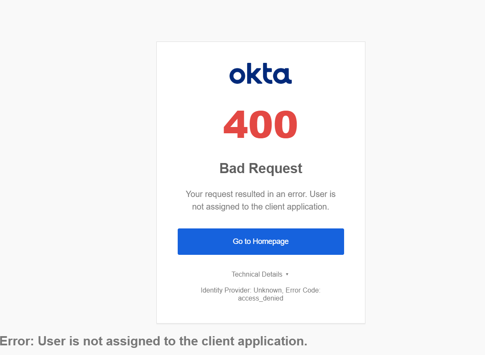
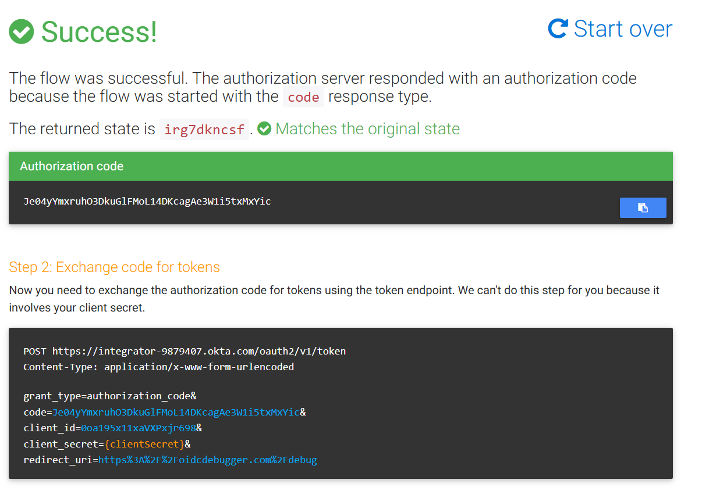
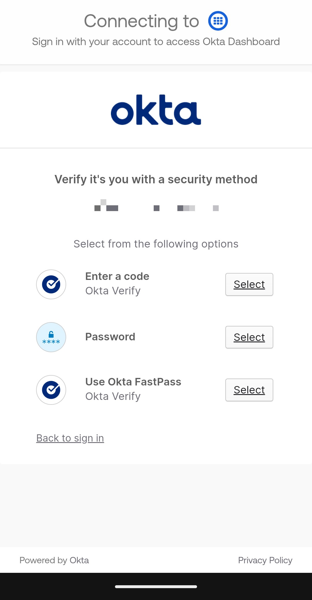
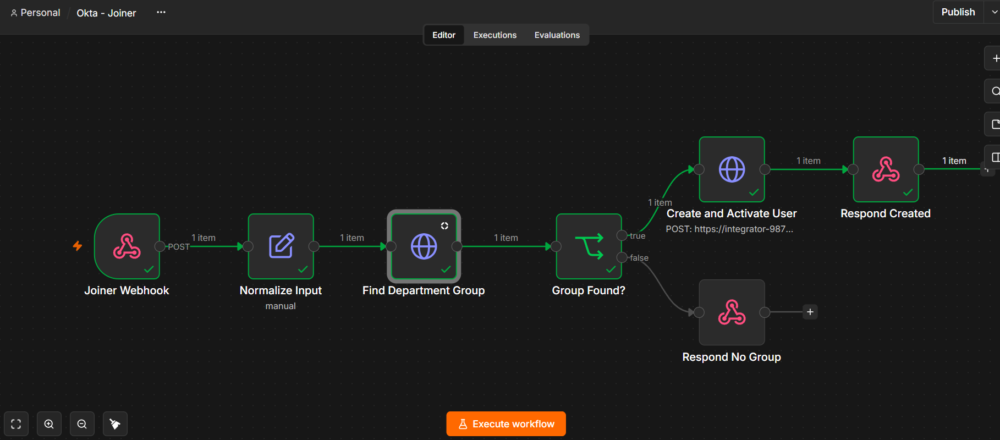
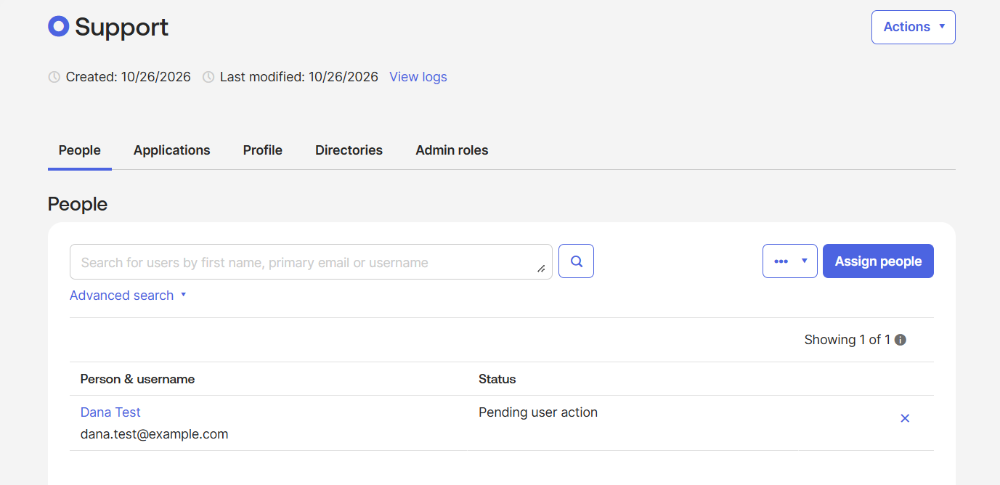
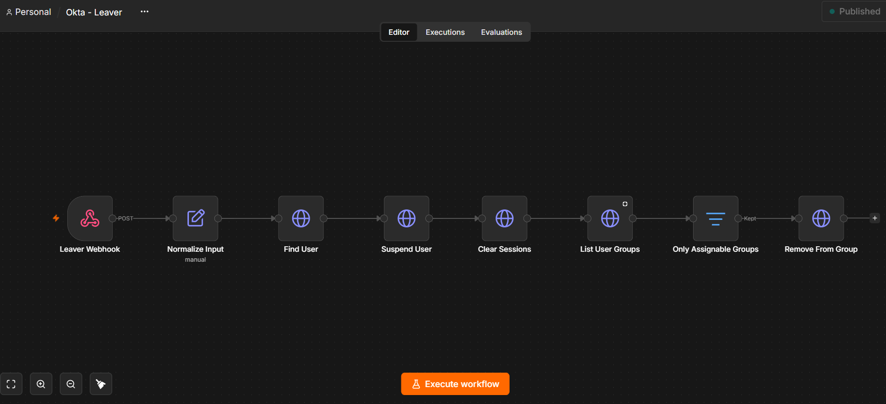
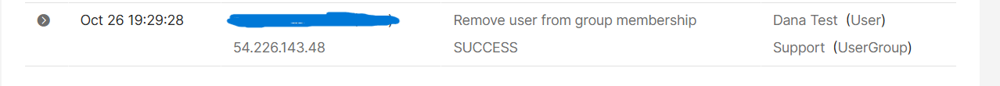
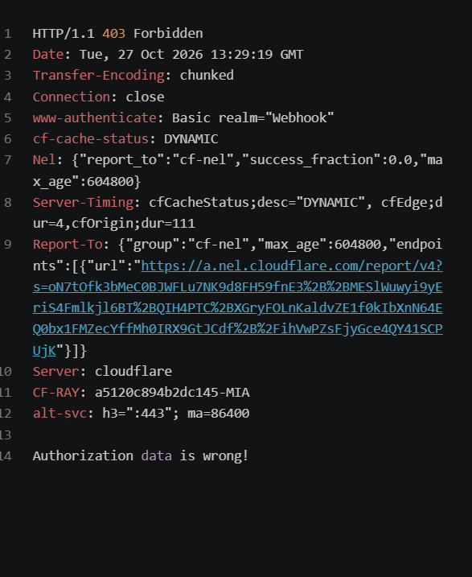
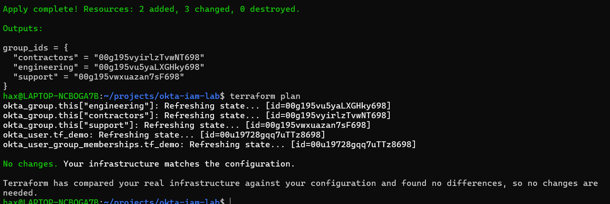

# Okta Identity Lifecycle Lab

A hands-on lab covering the core of identity and access management for IT systems work: SSO with OIDC, group-based access control, MFA, automated joiner/leaver provisioning through the Okta API, and the whole tenant brought under Terraform.

**Stack:** Okta Integrator tenant, OIDC, n8n (self-hosted, Docker), Terraform (`okta/okta` provider), Cloudflare, VS Code REST Client.

## What I built

1. **SSO and access control** - an OIDC web app assigned to groups, not individual users
2. **MFA** - an authentication policy requiring a second factor for the app
3. **Joiner automation** - one API call creates a user, activates them and places them in the right group
4. **Leaver automation** - one API call suspends the user, kills their sessions and removes group access
5. **Infrastructure as code** - groups imported into Terraform, plus a Terraform-owned user and membership

## 1. SSO, groups and MFA

- Created groups `Engineering`, `Support` and `Contractors`, and test users assigned to them.
- Created an OIDC web app and assigned it to the `Engineering` group only.
- Added an app sign-in policy requiring MFA (Okta Verify).
- Tested the flow with a browser OIDC debugger and a separate test user.

| Test | Result |
| --- | --- |
| User not in `Engineering` signs in to the app | Denied: user is not assigned to the app |
| Same user added to `Engineering` | Sign-in succeeds after the MFA prompt |





### Finding: Federation Broker Mode
My first "unassigned user" test unexpectedly succeeded. The app had **Federation Broker Mode** enabled, which lets every user in the org sign in regardless of assignments. Disabling it made group assignment the only path to access, and the denial test then behaved correctly. Worth checking on any new OIDC app.

## 2. Joiner / leaver automation (n8n)

Two webhook-triggered workflows call the Okta API. Exports are in [`n8n/`](n8n/) with credentials stripped.

**Joiner** (`POST /webhook/okta-joiner`)
`{ firstName, lastName, email, department }` -> look up the group whose name matches the department -> create and activate the user with that group in a single call -> respond with the new user ID. If no group matches, return a 400.

**Leaver** (`POST /webhook/okta-leaver`)
`{ email }` -> find the user -> suspend -> clear active sessions -> list their groups -> remove them from each assignable group. The workflow stops at **suspended** on purpose: suspend first, deactivate after a retention window, the usual offboarding pattern.






### Security decisions
- Okta API calls use an `SSWS` token held in an n8n credential, never in workflow JSON.
- The webhooks require a shared-secret header (Header Auth). A request without it returns 403.
- Production would use an OAuth 2.0 service app with scoped permissions (`okta.users.manage`, `okta.groups.manage`) instead of a broad API token, plus separate keys per webhook.



## 3. Terraform

`main.tf` manages the three groups, one demo user and its group membership.

- The groups were built by hand first, then **imported** (`terraform import`) so Terraform adopted them rather than recreating them.
- A final `terraform plan` shows no drift between Okta and the code.
- Users created by the n8n workflow are deliberately **not** declared in Terraform, so code and automation don't fight over them.



### Finding: exclusive group memberships
`okta_group_memberships` (plural) is exclusive: it makes the listed users the *only* members of a group and removes everyone else. Applied to `Support`, it would have removed users added by the joiner workflow. I used `okta_user_group_memberships`, which adds only the users it manages.

### Running it
```
export OKTA_ORG_NAME=<your-org>
export OKTA_BASE_URL=okta.com
read -s OKTA_API_TOKEN && export OKTA_API_TOKEN
terraform init
terraform plan
```
State and tokens are never committed (see `.gitignore`).

## Things that went wrong, and what they taught me
- **"Unable to sign in"** hid a typo in a test user's login. The Okta System Log would have shown the real reason immediately.
- **A silent Terraform hang** was a typo in `OKTA_BASE_URL`: the provider retried a host that didn't exist instead of failing fast. Check env vars before blaming the tool.
- **Header Auth in n8n** has two "name" fields: the credential's label and the actual HTTP header name. Mixing them produced "Header name must be a valid HTTP token".
- **`403 Authorization data is wrong`** looked like a Cloudflare block because every response carries `server: cloudflare`. The response body showed it was n8n rejecting a mismatched key.

## Next
- Add a SAML 2.0 app alongside OIDC
- Manage app assignments in Terraform
- Scheduled deactivation of suspended users after a retention period
- Switch the n8n integration to an OAuth service app
